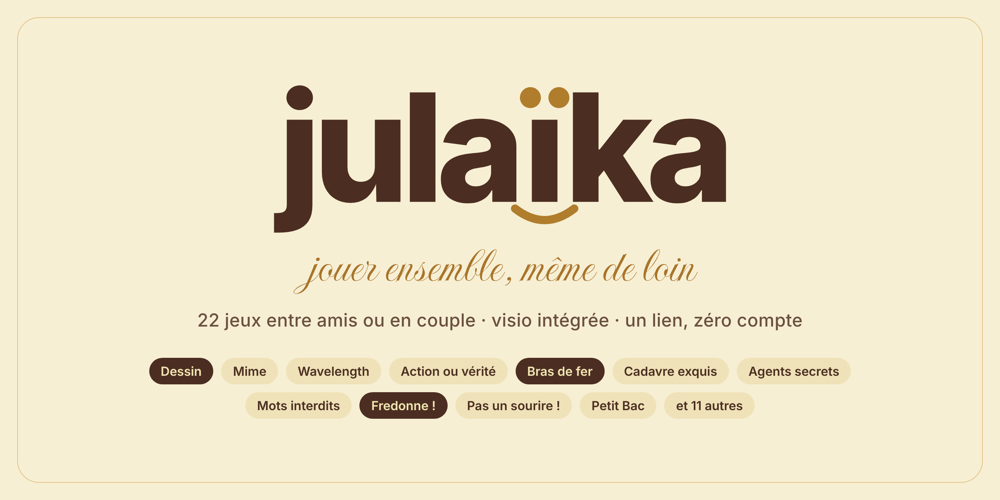
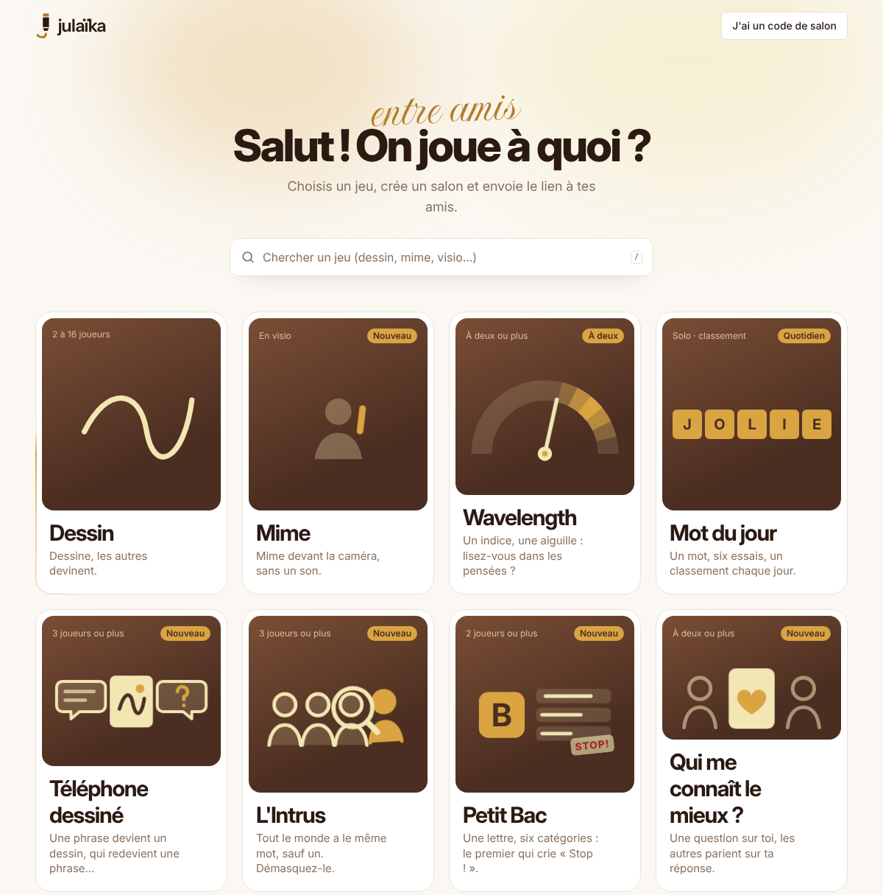
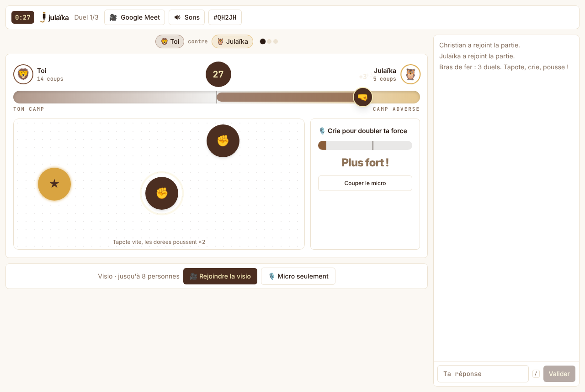
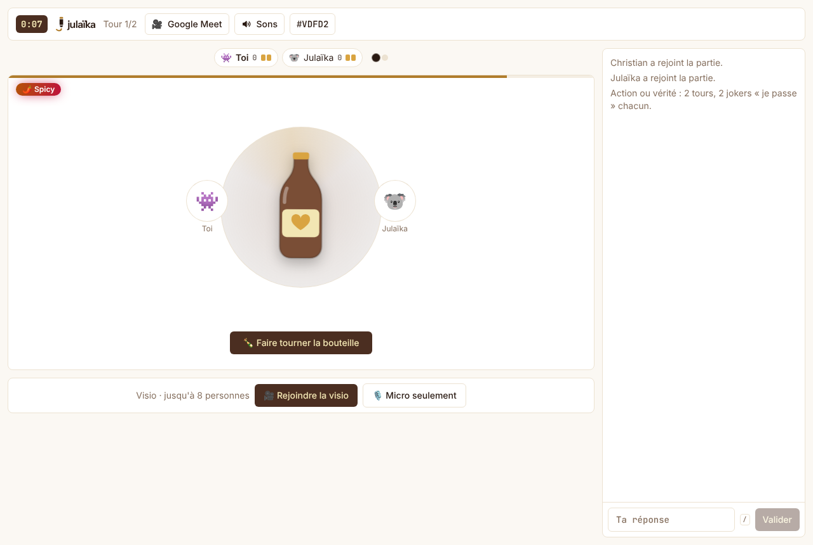
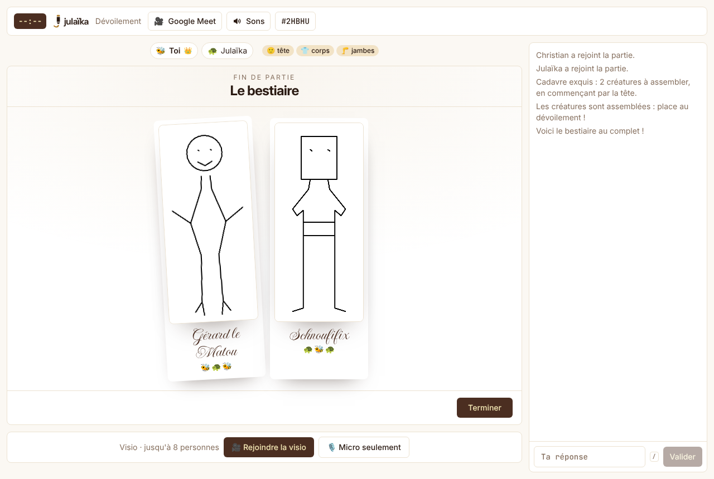
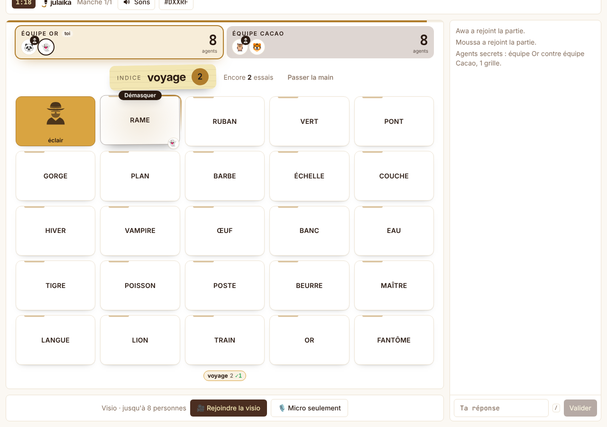
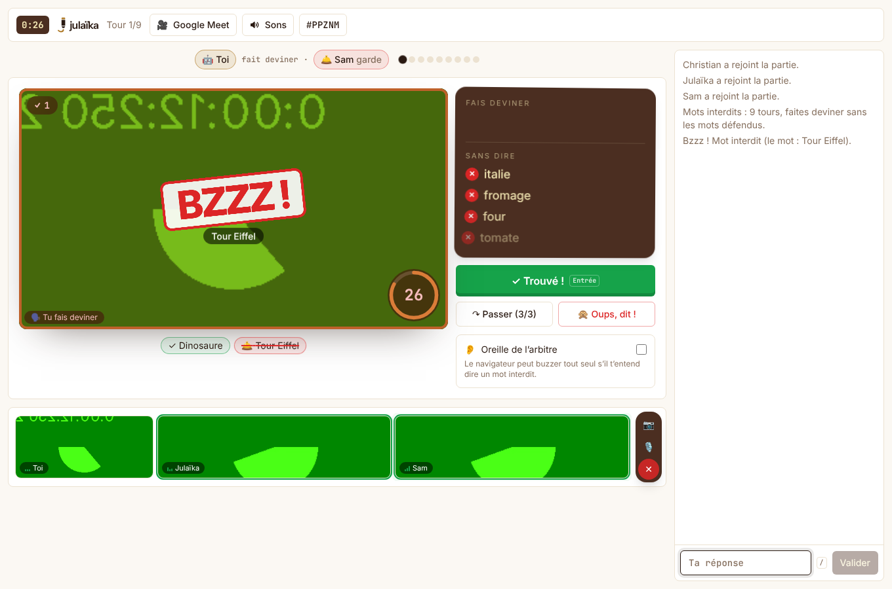
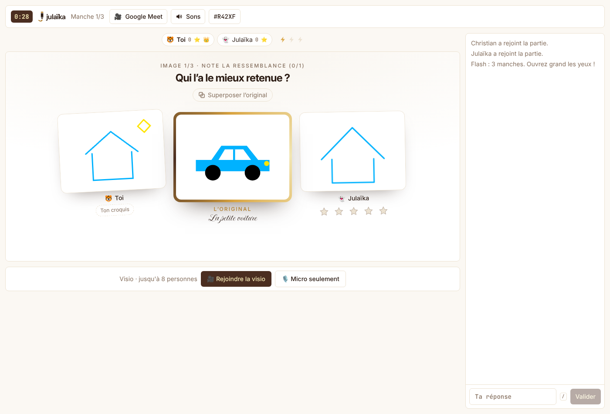

<p align="center">
  
</p>

<p align="center">
  <b>22 petits jeux à jouer entre amis ou en couple, avec la visio intégrée.</b><br />
  Un salon, un lien à partager, et on joue dans le navigateur. Sans compte, sans téléchargement.
</p>

<p align="center">
  <a href="https://julaika.2nbdigital.com"><b>Jouer maintenant</b></a> ·
  <a href="#les-jeux">Les jeux</a> ·
  <a href="#lancer-en-local">Lancer en local</a> ·
  <a href="#déployer">Déployer</a>
</p>

<p align="center">
  
  
  
  
  
  
</p>

<p align="center">
  
</p>

## En bref

- **Un lien suffit** : on choisit un jeu, on crée un salon, les amis arrivent directement dans la partie, sans inscription.
- **Pensé pour jouer à distance** : la visio et le micro sont intégrés au salon, et plusieurs jeux se jouent devant la caméra ou à la voix.
- **Beaucoup de jeux à deux** : la plupart marchent dès deux joueurs, parfaits pour un duo ou un couple ; d'autres montent jusqu'à 16.
- **Des cartes inventées par l'IA** (facultatif) : avec une clé DeepSeek, les mots, défis et questions sont générés à la volée, sinon le jeu pioche dans ses listes intégrées.
- **Léger et rapide** : un seul process Node sert le site et le WebSocket, le dessin voyage en binaire.
- **Thème Cacao** clair et sombre, qui suit le système, avec des micro-animations partout.

## Les jeux

| Jeu | Le principe | Joueurs |
| --- | --- | --- |
| **Dessin** | Dessine, les autres devinent dans le chat. Manches piégées en option. | 2 à 16 |
| **Mime** | Mime devant la caméra, sans un son. | En visio |
| **Wavelength** | Un indice, une aiguille : lisez-vous dans les pensées ? | À deux ou plus |
| **Mot du jour** | Un mot, six essais, un classement chaque jour. | Solo |
| **Téléphone dessiné** | Une phrase devient un dessin, qui redevient une phrase… | 3 ou plus |
| **L'Intrus** | Tout le monde a le même mot, sauf un. Démasquez-le. | 3 ou plus |
| **Petit Bac** | Une lettre, six catégories : le premier qui crie « Stop ! ». | 2 ou plus |
| **Qui me connaît le mieux ?** | Une question sur toi, les autres parient sur ta réponse. | À deux ou plus |
| **Bombe à mots** | Un mot avec la syllabe, vite, avant que ça saute ! | 2 à 16 |
| **Photomaton** | Une grimace sur commande, un flash, un polaroid. | En visio |
| **Pas un sourire !** | Garde ton sérieux pendant que l'autre fait le pitre. | En visio |
| **Bras de fer** | Tapote, crie, pousse la jauge chez l'autre. | À deux ou plus, micro |
| **Flash** | Trois secondes pour voir, quinze pour la redessiner. | À deux ou plus |
| **Cadavre exquis** | Tête, corps, jambes : chacun son morceau, sans voir le reste. | À deux ou plus |
| **Mots interdits** | Fais deviner à voix haute, sans les mots défendus. Bzzz ! | En visio |
| **Mot à mot** | Une histoire à plusieurs, un mot chacun, 4 secondes. | À deux ou plus |
| **Agents secrets** | Un seul mot pour démasquer tous tes agents. | Duo coop ou 2 équipes |
| **Fredonne !** | Fredonne une chanson au micro, les autres trouvent le titre. | À deux ou plus, micro |
| **L'Alibi** | Deux complices, 30 s pour accorder leur mensonge. Le juge veille. | 3 ou plus, visio |
| **Pitch saboté** | Vends un produit absurde en 60 s, malgré les diapos piégées. | En visio |
| **Cerveau coupé** | Un seul dessin à deux : l'un voit le modèle, l'autre tient le crayon. | À deux ou plus, micro |
| **Action ou vérité** | La bouteille tourne : Lite, Complice ou Spicy ? | En visio |

Le catalogue de l'accueil (noms, accroches, mots-clés de la recherche) vit dans
[`apps/client/src/lib/games.ts`](apps/client/src/lib/games.ts).

## Captures

<table>
  <tr>
    <td></td>
    <td></td>
  </tr>
  <tr>
    <td align="center">Bras de fer</td>
    <td align="center">Action ou vérité</td>
  </tr>
  <tr>
    <td></td>
    <td></td>
  </tr>
  <tr>
    <td align="center">Cadavre exquis</td>
    <td align="center">Agents secrets</td>
  </tr>
  <tr>
    <td></td>
    <td></td>
  </tr>
  <tr>
    <td align="center">Mots interdits</td>
    <td align="center">Flash</td>
  </tr>
</table>

## Lancer en local

Il faut Node 22 et pnpm 10 (`corepack enable` suffit).

```bash
pnpm install
pnpm dev          # client sur http://localhost:5173, WebSocket sur :3001
pnpm test         # logique des jeux et protocole (Vitest)
pnpm typecheck
pnpm build && pnpm start   # un seul process sur :3001 (site + WebSocket)
```

Toutes les variables sont facultatives ; le serveur lit un `.env` à la racine.

| Variable | Rôle |
| --- | --- |
| `DEEPSEEK_API_KEY` | Mots, défis et questions inventés par l'IA. Sans clé : listes intégrées. |
| `DEEPSEEK_MODEL`, `DEEPSEEK_BASE_URL` | Pour changer de modèle ou d'adresse d'API. |
| `TURN_URLS`, `TURN_SECRET` | Relais TURN de la visio pour les réseaux stricts (4G, entreprise). |
| `MOT_DATA_DIR`, `MOT_TZ` | Dossier des classements du Mot du jour et son fuseau (Europe/Paris par défaut). |
| `PORT` | Port du serveur (3001 par défaut). |

## Architecture

```
packages/shared   protocole : types JSON, encodage binaire du dessin, comparaison des réponses
apps/server       Node + ws : salons, une boucle autoritaire par jeu, minuteurs, scores, IA, signalisation WebRTC
apps/client       React 19 + Vite + Tailwind 4 : accueil, salon, un tableau par jeu, visio
tests             Vitest
deploy            Caddy, nginx, coturn et script de mise à jour du serveur
```

Chaque jeu a son fichier côté serveur (`apps/server/src/<jeu>.ts`) et son dossier côté client
(`apps/client/src/components/<jeu>/`). Quelques choix qui gardent l'ensemble léger :

- **Dessin en binaire** : 4 octets par point, couleur et taille en index, environ 6 fois moins
  qu'en JSON. Le serveur relaie le paquet sans le réencoder, groupé une fois par frame.
- **Minuteurs côté serveur** : le serveur envoie une échéance (`endsAt`), le client fait le
  compte à rebours et corrige le décalage d'horloge avec `ping`.
- **Store sans dépendance** (`useSyncExternalStore` et sélecteurs) : seuls les composants concernés se re-rendent.
- **IA jamais bloquante** : les lots de mots ou de cartes sont commandés à l'avance ; si l'API
  tarde ou échoue, le tour part avec la réserve intégrée. Plafond d'appels par heure pour tout le serveur.
- **Visio en pair à pair** : maillage WebRTC jusqu'à 8 personnes, vidéo plafonnée à 250 kb/s par
  flux, signalisation par le WebSocket du jeu, relais coturn en secours.
- Limitation de débit par connexion et heartbeat pour couper les sockets mortes.

## Déployer

Production : un VPS, derrière un Caddy partagé qui sert déjà d'autres sites sur 80/443.

1. DNS : un enregistrement `A` pour le sous-domaine vers l'IP du VPS.
2. Sur le VPS : cloner le dépôt dans `~/julaika`, puis lancer `deploy/deploy.sh` (construit
   l'image et démarre le conteneur `julaika` sur le réseau du Caddy).
3. Copier `deploy/julaika.caddy` dans le dossier des sites de Caddy et le recharger.
4. CI/CD : chaque push sur `main` lance les tests puis le déploiement par SSH
   (`.github/workflows/ci.yml`), une fois `VPS_HOST`, `VPS_USER` (variables) et `VPS_SSH_KEY`,
   `VPS_KNOWN_HOSTS` (secrets) renseignés. La clé est limitée côté serveur à
   `command="/home/<utilisateur>/julaika/deploy/deploy.sh",restrict`.

Relais de la visio : mettre `COMPOSE_PROFILES=turn`, `TURN_SECRET` et `TURN_URLS` dans `.env`,
ouvrir 3478 (tcp et udp) et 49160 à 49200 (udp). Réglages dans `deploy/turnserver.conf`.

VPS neuf sans autre site : `DOMAIN=jeu.exemple.com docker compose -f docker-compose.standalone.yml up -d --build`
(Caddy inclus, HTTPS automatique). Avec nginx à la place : `deploy/nginx.conf`.

## Identité

Le nom s'écrit **julaïka**, avec un i tréma. Sans accent, `julaika` reste réservé au code, aux
paquets, aux clés et au domaine.

Le logo « le sourire » : le tréma du ï devient deux yeux d'or et un sourire se dessine dessous,
clin d'œil au sourire de Julaïka. Signature : *jouer ensemble, même de loin*.

Les fichiers de marque sont dans [`docs/brand`](docs/brand) : `logo.svg` (fond clair),
`logo-dark.svg` (fond sombre), `mark.svg` (picto carré) et `cover.png`. Le lettrage est en contours
d'Inter 800, il ne dépend donc d'aucune police installée. Le lettrage et le picto existent aussi en
composants React (`Wordmark` et `LogoMark` dans `apps/client/src/components/Logo.tsx`), animés à l'arrivée sur l'accueil.
Favicon, icônes d'appli, manifest et image d'aperçu sont dans `apps/client/public`.

| Rôle | Couleur |
| --- | --- |
| Crème (fond clair) | `#F2E6B3` |
| Chocolat (encre, fond sombre) | `#4B2E21` |
| Or (accent, thème clair) | `#b07d2c` |
| Or (accent, thème sombre) | `#d6a24a` |

Polices : Inter pour l'interface et les titres, Imperial Script pour les accroches.
